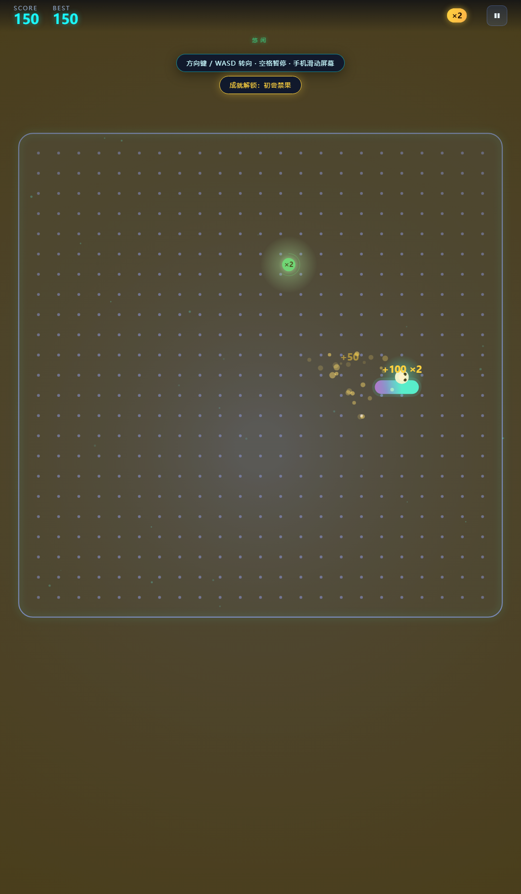
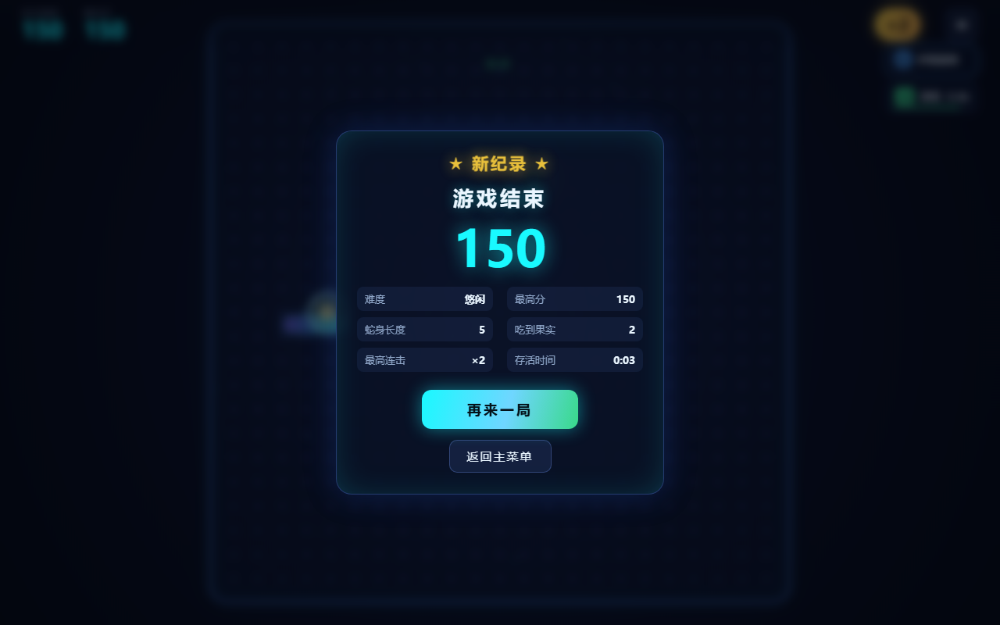

# 霓虹贪吃蛇 · Neon Snake

零依赖、纯 Canvas 的网页贪吃蛇：霓虹街机视觉 + 连击倍率 + 5 种道具果实 + 三档难度 + 合成音效，打开浏览器即玩。

## 永久网址

- **GitHub Pages**：https://yjm-only1.github.io/neon-snake/
- 仓库：https://github.com/yjm-only1/neon-snake

手机/电脑点开即玩，无需安装；最高分与成就保存在各自浏览器里。





## 快速开始

**方式一（推荐，双击即玩）**：直接打开根目录 `index.html`（构建产物，与 `deploy-site/index.html` 内容相同）。

**方式二（源码模式，需本地静态服务器）**：

```bash
cd E:/Game/neon-snake
python -m http.server 8000
# 浏览器访问 http://localhost:8000/dev.html
```

> 源码页 `dev.html` 使用 ES Modules，不支持 `file://` 直接打开（误开时会显示提示条）；单文件产物无此限制。

## 操作

| 输入 | 动作 |
|---|---|
| 方向键 / WASD | 转向（自动缓冲 2 步，禁止 180° 反转） |
| 空格 / Esc | 暂停 / 继续 |
| Enter | 菜单开局（沿用上次难度）/ 结算重开 |
| M | 静音音效 |
| 手机滑动屏幕 | 转向 |

## 玩法

- **三档难度**（各自独立最高分）：
  - 悠闲：6 格/秒，不加速，穿墙不死
  - 经典：8 格/秒，每 5 颗果实 +0.3 格/秒，撞墙即死
  - 狂暴：11 格/秒，每 3 颗果实 +0.5 格/秒，撞墙即死
- **5 种果实**：普通 +10、金果实 +50（6 秒内不吃会消失）、护盾（抵消一次死亡并穿行 1 秒）、减速（8 秒内 ×0.7 速度）、双倍分（10 秒内得分 ×2）
- **连击**：3 秒内连续吃到果实，得分倍率 ×2 ~ ×5
- **成就**：8 个成就，菜单「成就」页可查看
- **生涯统计**：总局数 / 总果实 / 最长蛇身 / 各档最高分，均保存在浏览器 localStorage

## 项目结构

```
dev.html              源码页面（本地服务器访问，引用 src/main.js）
index.html            单文件构建产物（双击即玩，由 build_single.py 生成）
css/style.css         霓虹主题样式
src/config.js         难度 / 食物 / 连击 / 成就 / 配色常量
src/game.js           核心模拟（纯逻辑无 DOM，可 Node 直跑）
src/storage.js        localStorage 持久化
src/audio.js          WebAudio 合成音效与动态 BGM（零素材）
src/input.js          键盘 + 触屏滑动
src/effects.js        粒子 / 飘字 / 震屏 / 闪光
src/render.js         Canvas 渲染（平滑插值 / 发光 / 穿墙断线）
src/ui.js             菜单 / HUD / 暂停 / 结算 / 成就 / 设置
src/main.js           状态机 + 主循环 + 成就判定
tools/build_single.py 单文件构建 → deploy-site/index.html
tools/sim/selftest.mjs 无头逻辑自测（44 项断言）
tools/e2e/smoke.mjs   真实 Chrome 端到端冒烟（需本机 Chrome）
deploy-site/          构建产物
```

## 发布

公开仓库 `yjm-only1/neon-snake` 发布**整个 neon-snake 工程**（源码、构建脚本、测试、截图均包含）；仓库根目录就是本工程目录，**工程目录之外的任何文件不得进入仓库**。

```bash
bash tools/publish_site.sh   # 构建单文件并推送到 main，GitHub Pages 自动发布
```

## 测试与构建

```bash
node tools/sim/selftest.mjs   # 逻辑自测：44 项断言
node tools/e2e/smoke.mjs      # 浏览器冒烟：开局→吃果→死亡→结算→存档→重开
python tools/build_single.py  # 重新生成根目录 index.html 与 deploy-site/index.html
```

## 技术要点

- 模拟与渲染分离：固定 60fps rAF 驱动、按「格/秒」步进，蛇身在格间插值渲染
- 音效/音乐全部由 WebAudio 振荡器实时合成，无任何音频素材文件
- 单文件构建：模块源码内联为 Blob 模块按拓扑序装载，产物可离线双击运行
- 调试入口：`index.html#play=classic` 可直接跳进对局（`chill` / `classic` / `insane`）